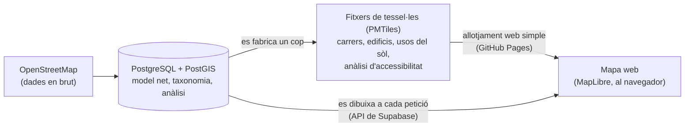

# Mapa de serveis de Barcelona: una arquitectura de mapa híbrida

[English](README.md) | [Español](README.es.md) | **Català**

Un mapa interactiu dels serveis de Barcelona (salut, educació, comerç, transport…) construït
amb dades d'OpenStreetMap. És un exercici de portafoli: el tema de fons és **com es pot
publicar un mapa web combinant dues tècniques diferents** i què permet cadascuna.

**▶ Demo en viu: [p-rubi.github.io/postgis-pmtiles-hybrid-map](https://p-rubi.github.io/postgis-pmtiles-hybrid-map/)**

*Cada edifici de la ciutat pintat segons la distància al centre d'atenció primària més proper
(punts vermells). Moure el control de llindar repinta tot el mapa a l'instant, sense cap
petició a cap servidor.*

---

## La idea en un minut

Tot mapa web resol el mateix problema: fer arribar moltes dades geogràfiques al navegador,
ràpid i barat. Hi ha dues maneres clàssiques de fer-ho, i aquest projecte fa servir totes dues
al mateix mapa.

| | **Tessel·les estàtiques** (PMTiles) | **Tessel·les vives** (des de la base de dades) |
|---|---|---|
| A què s'assembla | A un atles imprès: es fa un cop i es reparteix tal qual | A preguntar a un bibliotecari: respon al moment, amb el que demanes |
| Com funciona | El mapa es talla en peces i es desa en **un sol fitxer** en un allotjament web normal. El navegador només baixa les peces que està mirant | La **base de dades** dibuixa cada peça en el moment que el navegador la demana, aplicant-hi els filtres de l'usuari |
| Ideal per a | El que gairebé no canvia: carrers, edificis, usos del sòl, aigua | El que l'usuari filtra o algú pot editar: la capa de serveis, amb 12 categories i 61 subcategories |
| Cost | Pràcticament gratuït, sense servidor | Cal una base de dades en marxa |

La regla per decidir per on va cada capa és una sola pregunta: ***l'usuari necessita filtrar o
canviar aquesta capa mentre fa servir el mapa?*** Si no, es fabrica un cop com a fitxer
estàtic. Si sí, la genera la base de dades sota demanda. Fabricar un fitxer per a cada
combinació de filtres seria impossible; dibuixar els carrers des de la base de dades a cada
visita seria malbaratar recursos.

Hi ha una tercera via entremig: l'anàlisi d'accessibilitat de la imatge (a quina distància és
cada edifici de cada tipus de servei) es **calcula per endavant i es desa dins del fitxer
estàtic**, de manera que el navegador pot repintar desenes de milers d'edificis sense
preguntar res.

El navegador no nota la diferència: les dues fonts es pinten sobre el mateix llenç.

## Què s'hi pot fer

- **Explorar la ciutat a qualsevol escala.** De lluny, la base de dades agrupa els serveis
  propers i envia un símbol per grup amb el recompte, de manera que la vista inicial de tota la
  ciutat pesa uns **12 KB en lloc de 2 MB**. En apropar-s'hi, cada servei apareix per separat,
  acolorit per categoria.
- **Veure com n'és d'accessible cada edifici** respecte a un tipus de servei, amb un llindar de
  distància que es mou lliurement.
- **Dibuixar àrees d'influència**: la superfície a menys de 300 m, 500 m o 1 km d'algun servei
  del tipus triat, generada en viu per la base de dades.
- **Preguntar a la base de dades** amb un clic al mapa: els serveis més propers d'un tipus, o
  un resum de tot el que hi ha dins d'un radi, desglossat per categoria. El panell mostra quant
  ha trigat la base de dades a respondre.
- Fer-lo servir en **català, castellà o anglès**.

## En xifres

| | |
|---|---|
| Àmbit d'estudi | Terme municipal de Barcelona (101,8 km²) més un marge d'1 km |
| Elements del mapa | 84.356 trams de carrer, 70.342 edificis, 61.807 punts d'interès |
| Serveis | 39.035, ordenats amb una taxonomia pròpia en 12 categories i 61 subcategories (menys del 0,6 % sense classificar) |
| Base de dades | 176 MB, aproximadament un terç del pla gratuït |
| Tessel·les estàtiques | 13,7 MB de mapa base + 20,7 MB d'anàlisi d'accessibilitat |
| Cost de funcionament | **0 €**: plans gratuïts de Supabase i GitHub Pages, sense servidor propi |
| Reproductibilitat | Tot el procés, de la dada en brut al mapa, s'executa amb una sola ordre (uns 20 minuts) |

**Sobre la taxonomia.** OpenStreetMap no classifica els llocs: els descriu amb milers
d'etiquetes lliures. Una anàlisi estadística de totes les etiquetes de la zona va donar lloc a
una classificació de dos nivells, aplicada per regles desades en fitxers CSV (dades, no codi).
Les regles miren l'etiqueta, el nom (un CAP etiquetat de manera genèrica es reconeix pel nom) i
el context (accés públic o privat, superfície, proximitat a un equipament).

## Tecnologia

| Peça | Eina |
|---|---|
| Base de dades espacial | PostgreSQL + PostGIS |
| API | PostgREST sobre Supabase: tessel·les vectorials vives (`ST_AsMVT`), vistes JSON i funcions de consulta |
| Tessel·les estàtiques | PMTiles, generades amb tippecanoe |
| Mapa web | MapLibre GL JS, mòduls JavaScript nadius, sense framework ni compilació |
| Allotjament | GitHub Pages (mapa i tessel·les) + Supabase (base de dades) |

## Què hi ha en aquest repositori

| Ruta | Contingut |
|---|---|
| [`web/`](web/) | Codi font del visor (comentaris en català) |
| [`.github/workflows/keepalive.yml`](.github/workflows/keepalive.yml) | Manté desperta la base de dades gratuïta (vegeu més avall) |
| Branca `gh-pages` | El lloc publicat, amb els fitxers de tessel·les |

El procés de dades (importació des d'OpenStreetMap, model de la base de dades, taxonomia,
anàlisis, generació de tessel·les, scripts de desplegament i tests d'integritat) és en un
repositori privat. L'ensenyo de gust.

**Keep-alive.** Supabase posa en pausa els projectes gratuïts després d'una setmana sense
activitat. Una GitHub Action programada fa una petició real a l'API a hores variables, de
mitjana un cop al dia, triant a l'atzar entre les peticions que fa el mateix mapa. Si una
petició falla, GitHub m'avisa per correu.

## Abast i limitacions

- Les distàncies són en línia recta, no per la xarxa de carrers. És una simplificació
  declarada: l'anàlisi per xarxa és un altre problema i no és el que aquest projecte vol
  mostrar.
- OpenStreetMap no és cartografia oficial i pot ser incomplet. A canvi, ofereix la mateixa
  cobertura a qualsevol lloc del món: el projecte es pot apuntar a una altra zona canviant tres
  paràmetres.
- Només s'analitzen els edificis mapats a OpenStreetMap.
- Al pla gratuït, la primera petició després d'una estona sense ús pot trigar uns segons.

## Dades i llicències

- Dades: © col·laboradors d'OpenStreetMap, [ODbL 1.0](https://opendatacommons.org/licenses/odbl/).
- Límits administratius: © Institut Cartogràfic i Geològic de Catalunya (ICGC), CC BY 4.0.
- Glifs del número dels grups (`web/fonts/`): Noto Sans, © The Noto Project Authors, [SIL OFL 1.1](web/fonts/OFL.txt).
