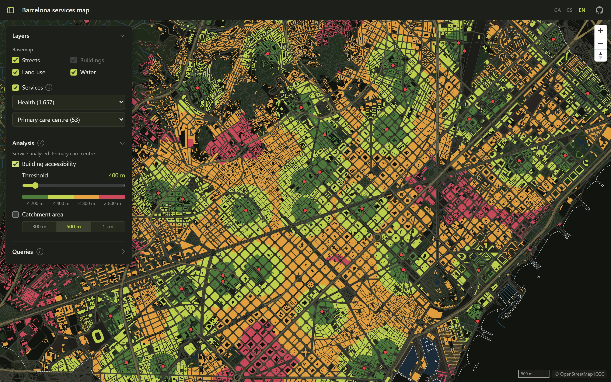
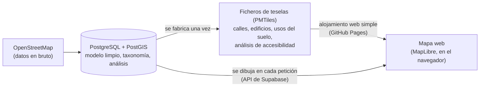

# Mapa de servicios de Barcelona: una arquitectura de mapa híbrida

[English](README.md) | **Español** | [Català](README.ca.md)

Un mapa interactivo de los servicios de Barcelona (salud, educación, comercio, transporte…)
construido con datos de OpenStreetMap. Es un ejercicio de portfolio: su tema de fondo es
**cómo publicar un mapa web combinando dos técnicas distintas** y qué permite cada una.

**▶ Demo en vivo: [p-rubi.github.io/postgis-pmtiles-hybrid-map](https://p-rubi.github.io/postgis-pmtiles-hybrid-map/)**

*Cada edificio de la ciudad coloreado según su distancia al centro de atención primaria más
cercano (puntos rojos). Mover el control de umbral recolorea todo el mapa al instante, sin
ninguna petición a ningún servidor.*

---

## La idea en un minuto

Todo mapa web resuelve el mismo problema: hacer llegar muchos datos geográficos al navegador,
rápido y barato. Hay dos maneras clásicas de hacerlo, y este proyecto usa las dos en el mismo
mapa.

| | **Teselas estáticas** (PMTiles) | **Teselas vivas** (desde la base de datos) |
|---|---|---|
| A qué se parece | A un atlas impreso: se hace una vez y se reparte tal cual | A preguntar a un bibliotecario: responde en el momento, con lo que pides |
| Cómo funciona | El mapa se corta en piezas y se guarda en **un solo fichero** en un alojamiento web normal. El navegador descarga sólo las piezas que está mirando | La **base de datos** dibuja cada pieza en el momento en que el navegador la pide, aplicando los filtros del usuario |
| Ideal para | Lo que casi no cambia: calles, edificios, usos del suelo, agua | Lo que el usuario filtra o alguien puede editar: la capa de servicios, con 12 categorías y 61 subcategorías |
| Coste | Prácticamente gratis, sin servidor | Necesita una base de datos en marcha |

La regla para decidir qué capa va por cada lado es una sola pregunta: ***¿necesita el usuario
filtrar o cambiar esta capa mientras usa el mapa?*** Si no, se fabrica una vez como fichero
estático. Si sí, la genera la base de datos bajo demanda. Fabricar un fichero para cada
combinación de filtros sería imposible; dibujar las calles desde la base de datos en cada
visita sería un desperdicio.

Hay una tercera vía intermedia: el análisis de accesibilidad de la imagen (a qué distancia está
cada edificio de cada tipo de servicio) se **calcula de antemano y se guarda dentro del fichero
estático**, así que el navegador puede recolorear decenas de miles de edificios sin preguntar
nada.

El navegador no nota la diferencia: las dos fuentes se pintan sobre el mismo lienzo.

## Qué se puede hacer

- **Explorar la ciudad a cualquier escala.** De lejos, la base de datos agrupa los servicios
  cercanos y envía un símbolo por grupo con su recuento, así que la vista inicial de toda la
  ciudad pesa unos **12 KB en lugar de 2 MB**. Al acercarse, cada servicio aparece por
  separado, coloreado por categoría.
- **Ver lo accesible que es cada edificio** respecto a un tipo de servicio, con un umbral de
  distancia que se mueve libremente.
- **Dibujar áreas de influencia**: la superficie a menos de 300 m, 500 m o 1 km de algún
  servicio del tipo elegido, generada en vivo por la base de datos.
- **Preguntar a la base de datos** con un clic en el mapa: los servicios más cercanos de un
  tipo, o un resumen de todo lo que hay dentro de un radio, desglosado por categoría. El panel
  muestra cuánto ha tardado la base de datos en responder.
- Usarlo en **catalán, castellano o inglés**.

## En cifras

| | |
|---|---|
| Zona de estudio | Municipio de Barcelona (101,8 km²) más un margen de 1 km |
| Elementos del mapa | 84.356 tramos de calle, 70.342 edificios, 61.807 puntos de interés |
| Servicios | 39.035, ordenados con una taxonomía propia en 12 categorías y 61 subcategorías (menos del 0,6 % sin clasificar) |
| Base de datos | 176 MB, aproximadamente un tercio del plan gratuito |
| Teselas estáticas | 13,7 MB de mapa base + 20,7 MB de análisis de accesibilidad |
| Coste de funcionamiento | **0 €**: planes gratuitos de Supabase y GitHub Pages, sin servidor propio |
| Reproducibilidad | Todo el proceso, del dato en bruto al mapa, se ejecuta con una sola orden (unos 20 minutos) |

**Sobre la taxonomía.** OpenStreetMap no clasifica los lugares: los describe con miles de
etiquetas libres. Un análisis estadístico de todas las etiquetas de la zona dio lugar a una
clasificación de dos niveles, aplicada por reglas guardadas en ficheros CSV (datos, no código).
Las reglas miran la etiqueta, el nombre (un centro de salud etiquetado de forma genérica se
reconoce por el nombre) y el contexto (acceso público o privado, tamaño, proximidad a un
equipamiento).

## Tecnología

| Pieza | Herramienta |
|---|---|
| Base de datos espacial | PostgreSQL + PostGIS |
| API | PostgREST sobre Supabase: teselas vectoriales vivas (`ST_AsMVT`), vistas JSON y funciones de consulta |
| Teselas estáticas | PMTiles, generadas con tippecanoe |
| Mapa web | MapLibre GL JS, módulos JavaScript nativos, sin framework ni compilación |
| Alojamiento | GitHub Pages (mapa y teselas) + Supabase (base de datos) |

## Qué hay en este repositorio

| Ruta | Contenido |
|---|---|
| [`web/`](web/) | Código fuente del visor (comentarios en catalán) |
| [`.github/workflows/keepalive.yml`](.github/workflows/keepalive.yml) | Mantiene despierta la base de datos gratuita (ver abajo) |
| Rama `gh-pages` | El sitio publicado, con los ficheros de teselas |

El proceso de datos (importación desde OpenStreetMap, modelo de la base de datos, taxonomía,
análisis, generación de teselas, scripts de despliegue y tests de integridad) está en un
repositorio privado. Lo enseño con gusto.

**Keep-alive.** Supabase pausa los proyectos gratuitos tras una semana sin actividad. Una
GitHub Action programada hace una petición real a la API a horas variables, de media una vez
al día, eligiendo al azar entre las peticiones que hace el propio mapa. Si una petición falla,
GitHub me avisa por correo.

## Alcance y limitaciones

- Las distancias son en línea recta, no por la red de calles. Es una simplificación declarada:
  el análisis por red es otro problema y no es lo que este proyecto quiere mostrar.
- OpenStreetMap no es cartografía oficial y puede estar incompleto. A cambio, ofrece la misma
  cobertura en cualquier lugar del mundo: el proyecto se puede apuntar a otra zona cambiando
  tres parámetros.
- Sólo se analizan los edificios mapeados en OpenStreetMap.
- En el plan gratuito, la primera petición tras un rato sin uso puede tardar unos segundos.

## Datos y licencias

- Datos: © colaboradores de OpenStreetMap, [ODbL 1.0](https://opendatacommons.org/licenses/odbl/).
- Límites administrativos: © Institut Cartogràfic i Geològic de Catalunya (ICGC), CC BY 4.0.
- Glifos del número de los grupos (`web/fonts/`): Noto Sans, © The Noto Project Authors, [SIL OFL 1.1](web/fonts/OFL.txt).
