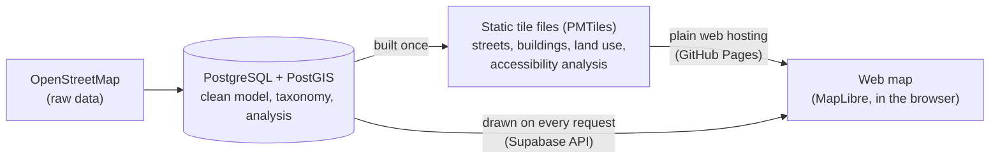

# Barcelona services map: a hybrid map architecture

**English** | [Español](README.es.md) | [Català](README.ca.md)

An interactive map of the services of Barcelona (health, education, shops, transport…) built
from OpenStreetMap data. It is a portfolio exercise: its real subject is **how a web map can be
published by combining two different techniques**, and what each one makes possible.

**▶ Live demo: [p-rubi.github.io/postgis-pmtiles-hybrid-map](https://p-rubi.github.io/postgis-pmtiles-hybrid-map/)**

*Every building in the city coloured by its distance to the nearest primary care centre (red
dots). Moving the threshold slider recolours the whole map instantly, with no request to any
server.*

---

## The idea in one minute

Every web map has to solve the same problem: getting a large amount of geographic data to a
browser quickly and cheaply. There are two classic ways to do it, and this project uses both
on the same map.

| | **Static tiles** (PMTiles) | **Live tiles** (from the database) |
|---|---|---|
| What it is like | A printed atlas: produced once, handed out as is | Asking a librarian: answered on the spot, with exactly what you asked for |
| How it works | The map is cut into pieces and saved in **one file** on ordinary web hosting. The browser downloads only the pieces it is looking at | The **database** draws each piece the moment the browser asks for it, applying the user's filters |
| Best for | Things that rarely change: streets, buildings, land use, water | Things the user filters or that someone may edit: the services layer, with 12 categories and 61 subcategories |
| Cost | Practically free, no server | A database must be running |

The rule used to decide which layer goes where is a single question: ***does the user need to
filter or change this layer while using the map?*** If not, it is pre-built once as a static
file. If so, the database produces it on demand. Pre-building a file for every possible filter
combination would be impossible; drawing streets from the database on every visit would be
wasteful.

A third option sits in between: the accessibility analysis in the image above (how far each
building is from each type of service) is **calculated in advance and stored inside the static
file**, so the browser can recolour tens of thousands of buildings without asking anything.

The browser does not see the difference: both sources are painted on the same map canvas.

## What you can do with it

- **Explore the city at any scale.** From afar, the database groups nearby services and sends
  one symbol per group with its count, so the initial view of the whole city weighs about
  **12 KB instead of 2 MB**. Closer in, each service appears on its own, coloured by category.
- **See how accessible each building is** to a type of service, with a distance threshold you
  can move freely.
- **Draw catchment areas**: the area within 300 m, 500 m or 1 km of any service of the chosen
  type, generated live by the database.
- **Ask the database questions** by clicking on the map: the nearest services of a type, or a
  summary of everything within a radius, broken down by category. The panel shows how long the
  database took to answer.
- Use it in **Catalan, Spanish or English**.

## In numbers

| | |
|---|---|
| Study area | Municipality of Barcelona (101.8 km²) plus a 1 km margin |
| Map features | 84,356 street segments, 70,342 buildings, 61,807 points of interest |
| Services | 39,035, sorted by an in-house taxonomy into 12 categories and 61 subcategories (less than 0.6 % left unclassified) |
| Database | 176 MB, about a third of the free plan |
| Static tiles | 13.7 MB base map + 20.7 MB accessibility analysis |
| Running cost | **0 €**: free tiers of Supabase and GitHub Pages, no server of my own |
| Reproducibility | The whole pipeline, from raw data to map, runs with one command (about 20 minutes) |

**About the taxonomy.** OpenStreetMap does not classify places: it labels them with thousands
of free-form tags. A statistical review of every tag in the area led to a two-level
classification, applied by rules kept in plain CSV files (data, not code). The rules look at
the tag, the name (a clinic tagged generically is recognised by its name) and the context
(public or private access, size, proximity to a facility).

## Technology

| Piece | Tool |
|---|---|
| Spatial database | PostgreSQL + PostGIS |
| API | PostgREST on Supabase: live vector tiles (`ST_AsMVT`), JSON views and query functions |
| Static tiles | PMTiles, built with tippecanoe |
| Web map | MapLibre GL JS, plain JavaScript modules, no framework or build step |
| Hosting | GitHub Pages (map and tile files) + Supabase (database) |

## What is in this repository

| Path | Contents |
|---|---|
| [`web/`](web/) | Source code of the map viewer (comments in Catalan) |
| [`.github/workflows/keepalive.yml`](.github/workflows/keepalive.yml) | Keeps the free database awake (see below) |
| `gh-pages` branch | The published site, including the tile files |

The data pipeline (import from OpenStreetMap, database model, taxonomy, analyses, tile
generation, deployment scripts and integrity tests) lives in a private repository. I am happy
to walk through it.

**Keep-alive.** Supabase pauses free projects after a week without activity. A scheduled
GitHub Action makes one real request to the API at varying times, on average about once a day,
choosing at random among the requests the map itself makes. If a request fails, GitHub emails
me.

## Scope and limitations

- Distances are straight-line, not along the street network. It is a declared simplification:
  network analysis is a different problem and not what this project sets out to show.
- OpenStreetMap is not official cartography and may be incomplete. In exchange it offers the
  same coverage anywhere in the world: the project can be pointed at another area by changing
  three settings.
- Only buildings mapped in OpenStreetMap are analysed.
- On the free plan, the first request after a quiet period may take a few seconds.

## Data and licences

- Data: © OpenStreetMap contributors, [ODbL 1.0](https://opendatacommons.org/licenses/odbl/).
- Administrative boundaries: © Institut Cartogràfic i Geològic de Catalunya (ICGC), CC BY 4.0.
- Cluster label glyphs (`web/fonts/`): Noto Sans, © The Noto Project Authors, [SIL OFL 1.1](web/fonts/OFL.txt).
